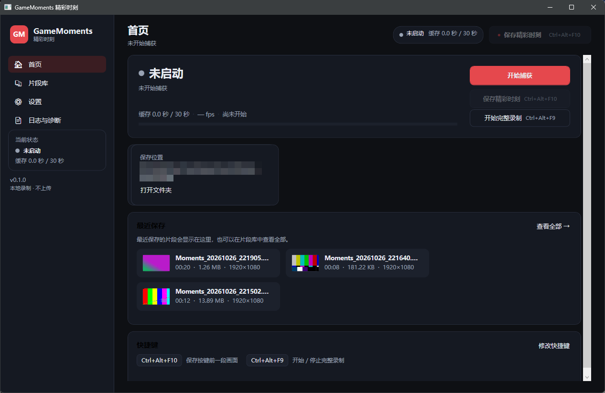

# GameMoments 精彩时刻

一个完全本地运行的 Windows 即时回放录制工具：它持续把最近一段时间（15/30/60/120 秒）的画面写入环形缓存，按下快捷键即可把“刚才那段”保存成 MP4；也可以随时开始/停止完整录制。灵感来自 SteelSeries Moments，但不依赖任何游戏平台或硬件厂商软件。

> 当前版本 **0.1.0**，面向 Windows 10/11 x64。默认界面为中文，所有素材只写入本机。



## 功能

### 已实现并实测

| 功能 | 说明 |
| --- | --- |
| 即时回放缓存 | 15/30/60/120 秒可选，按 1 秒一个 MP4 分段滚动写入，超出窗口自动删除最旧分段，并按磁盘上限（默认 20 GB）二次保护 |
| 保存精彩时刻 | 默认 `Ctrl+Alt+F10`，保存按键前一段 + 可选按键后 0/5/10 秒；保存期间锁定所需分段，不会清空未写完的数据 |
| 完整录制 | 默认 `Ctrl+Alt+F9` 开始/停止，产物与回放片段同一套命名与片段库 |
| 捕获源 | 自动枚举显示器，可指定显示器；桌面复制（DDA/GPU 零拷贝）优先，GDI 兼容回退 |
| 编码 | 启动时真实探测“捕获 + 编码器”组合：NVENC / AMF / QSV / Media Foundation 优先，失败自动回退 libx264；支持 30/60 fps 与三档画质 |
| 音频 | 系统声音（默认输出设备 loopback）与麦克风独立开关、独立音量；统一 48 kHz 双声道，按墙钟补静音保证音画对齐；保存时裁剪并混流为 AAC |
| 输出 | MP4（H.264 + AAC，faststart），自动生成 JPG 缩略图；文件名前缀 + 时间戳 |
| 片段库 | 列表、搜索、缩略图、时长/分辨率/大小/有无音频等元数据、播放、打开所在位置、重命名、删除（进回收站并二次确认）、刷新与占用统计 |
| 设置 | 捕获显示器/方式/编码器、帧率、缓存时长、按键后时长、画质、文件名前缀、音频设备与音量、两个全局快捷键、保存目录、托盘行为、日志保留天数；保存、恢复默认、导出诊断包 |
| 全局快捷键 | 可配置，注册失败（如 1409 被占用）会明确提示并保留界面按钮作为替代操作 |
| 托盘与引导 | 托盘图标、最小化/关闭到托盘、托盘菜单、保存通知、首次运行三步引导 |
| 日志与诊断 | 按天 JSONL 日志（不记录窗口标题、账号、画面），日志页可刷新/打开目录/导出 zip 诊断包（系统信息 + 设置 + 日志） |
| 隐私 | 只写本地目录，不联网上传，不采集密码；日志中的用户目录会脱敏为 `%USERPROFILE%` |

### 未实现 / 部分实现

- **窗口捕获**：只支持整块显示器，不支持指定某个窗口或游戏进程。
- **P1 能力**：按游戏自动识别事件、裁剪/修剪、批量导出、分享、录制浮层、崩溃恢复均未实现。
- **HDR、全屏独占、DRM 内容、反作弊保护**：不保证可捕获，也不会尝试绕过任何保护；这类场景可能黑屏或直接失败。
- **同步精度**：分段粒度为 1 秒，片段起点与音频裁剪按墙钟对齐，误差约 ±1 秒；不是逐帧级精确剪辑。
- **多显示器**：一次只录一个显示器；混合 DPI / 不同刷新率未做深入测试。
- **帧率**：只提供 30/60，未开放 120/144。
- **安装与更新**：没有 MSI/安装器、代码签名、自动更新。

## 技术方案

```
┌──────────────┐   DDA / GDI    ┌──────────────┐  1s 分段 MP4  ┌────────────────┐
│ 显示器 / 桌面 │ ─────────────► │ ffmpeg 子进程 │ ────────────► │ 会话分段目录     │
└──────────────┘                │ + NVENC/x264 │               │ seg_00000.mp4… │
                                └──────────────┘               └───────┬────────┘
                                                                       │ 环形窗口
┌──────────────┐  WASAPI loopback / mic  ┌──────────────────┐          │
│ 系统声音/麦克风│ ─────────────────────► │ 采集线程 → 48k 立体声│          │
└──────────────┘                         │ → 1s WAV 分块     │          │
                                         └────────┬─────────┘          │
                                                  │ 按墙钟裁剪          │
                        ┌─────────────────────────▼────────────────────▼─────────┐
                        │ 保存：concat 分段（-c copy）→ 混音 AAC → MP4 + 缩略图      │
                        │       → clips.json 索引 → 界面通知 / 片段库              │
                        └────────────────────────────────────────────────────────┘
```

- **捕获/编码**：`ffmpeg` 子进程。桌面复制用 `ddagrab`（GPU 纹理直接进编码器），兼容回退 `gdigrab`；编码器优先硬件，失败回退 `libx264`。启动时用一个 0.6 秒的空输出探测组合，只有真实成功才启用。
- **环形缓存**：`-f segment -segment_time 1 -reset_timestamps 1`，每段以关键帧开头；`SegmentRing` 维护索引、按窗口/磁盘上限清理，保存时对所需分段 pin 引用计数。
- **音画同步**：以分段文件创建时间作为墙钟锚点；音频从会话开始按已采集帧数累计，缺数据补静音；保存时按 `片段起点 - 音频会话起点` 从 WAV 分块中裁剪等长 PCM。
- **音频**：NAudio 的 WASAPI loopback / 采集，`PcmConverter` 统一为 float32 立体声，线性重采样到 48 kHz，`ChunkedWavSink` 每秒落一个 WAV 分块。
- **组装**：`ffmpeg -f concat -c copy` 拼视频，WAV 侧裁剪拼接后与视频 `-c:v copy` 混流为 AAC 192 kbps。
- **界面**：WPF（.NET 10），深色主题、中文文案；`MainViewModel` 通过事件把引擎状态推给界面，所有状态文字来自真实后台状态。
- **数据**：默认 `%LOCALAPPDATA%\GameMoments`（可用环境变量 `GAMEMOMENTS_DATA` 覆盖），片段默认保存到 `%USERPROFILE%\Videos\GameMoments`（不可写时自动回退到数据目录 `clips`）。

## 目录结构

```
GameMoments/
├─ src/
│  ├─ GameMoments.Core/          # 无 UI 依赖的核心库
│  │  ├─ Audio/                  # WASAPI 设备、PCM 转换、重采样、WAV 分块、采集轨
│  │  ├─ Capture/                # SegmentRing（环形缓存）、CaptureEngine（会话/保存）
│  │  ├─ Clips/                  # ClipRecord、索引、片段库、组装、回收站
│  │  ├─ Configuration/          # 设置模型、持久化、画质预设
│  │  ├─ Hotkeys/                # 快捷键解析、RegisterHotKey 封装
│  │  ├─ Logging/                # JSONL 日志
│  │  ├─ Media/                  # ffmpeg 定位/能力/命令、探测、进度解析
│  │  ├─ Platform/               # 路径、显示器、进程、隐私脱敏
│  │  └─ Support/                # 诊断包
│  ├─ GameMoments.App/           # WPF 界面（首页/片段库/设置/日志）
│  └─ GameMoments.Cli/           # 开发与验证用命令行（doctor/devices/clips/capture/record）
├─ tests/GameMoments.Tests/      # 无依赖控制台测试（23 项）
├─ tools/ffmpeg/                 # 开发期 ffmpeg 6.1.1 + ffprobe
├─ docs/screenshots/             # 实机截图
└─ dist/GameMoments-0.1.0-win-x64/  # 可运行发布包（自包含 + 内置 ffmpeg）
```

## 构建与运行

环境要求：Windows 10/11 x64、.NET SDK 10（仅构建需要；发布包自包含，运行时不需要装 .NET）。

仓库不包含 ffmpeg 二进制（约 158 MB）。首次构建或运行前，先取回 ffmpeg 6.1.1 到 `tools/ffmpeg/`：

```powershell
node tools/fetch-ffmpeg.mjs
```

应用会依次在以下位置寻找 ffmpeg：设置里的路径、`GAMEMOMENTS_FFMPEG_DIR`、程序目录下的 `ffmpeg/`、向上查找的 `tools/ffmpeg/`、PATH。

```powershell
# 构建
dotnet build GameMoments.slnx -c Release

# 直接运行源码
dotnet run --project src/GameMoments.App -c Release

# 运行测试（控制台 runner，PASS/FAIL + 退出码）
dotnet build tests/GameMoments.Tests -c Release
tests/GameMoments.Tests/bin/Release/net10.0-windows/GameMoments.Tests.exe

# 重新发布（自包含）
dotnet publish src/GameMoments.App -c Release -r win-x64 --self-contained true `
  -o dist/GameMoments-0.1.0-win-x64
# 再把 tools/ffmpeg 下的 ffmpeg.exe / ffprobe.exe 复制到发布目录的 ffmpeg/ 子目录
```

运行发布包：双击 `dist/GameMoments-0.1.0-win-x64/GameMoments.exe`（或 `run.cmd`）。

开发时可用环境变量隔离数据与指定 ffmpeg：

```powershell
$env:GAMEMOMENTS_DATA = "D:\tmp\gm-data"
$env:GAMEMOMENTS_FFMPEG_DIR = "D:\path\to\ffmpeg"   # 目录内需同时有 ffmpeg.exe 与 ffprobe.exe
```

## 使用说明

1. 首次启动会显示三步引导：确认保存目录与捕获设置 → 开始捕获让缓存滚动 → 用快捷键保存或在片段库管理。
2. 首页点“开始捕获”，等状态变成“缓存就绪”（大约等于缓存时长），按 `Ctrl+Alt+F10` 即可保存刚才一段；默认快捷键可在设置里修改。
3. `Ctrl+Alt+F9` 开始/停止完整录制。
4. 设置页可切换显示器、捕获方式、编码器、帧率、缓存长度、按键后时长、画质、音频设备与音量、保存目录、托盘行为。
5. 关闭窗口默认“隐藏到托盘”，录制继续；从托盘菜单“退出”才真正停止。
6. 片段库支持播放、打开所在位置、重命名、删除（回收站，需确认）和搜索。

## 验证结果（本机实测，2026-10-26）

- 构建：`dotnet build GameMoments.slnx -c Release` 成功，0 错误。
- 自动化测试：`GameMoments.Tests.exe` → **通过 23，失败 0**（快捷键解析/格式化、设置收敛、文件名清理、WAV 读写与静音补齐、SegmentRing 扫描/清理/pin/范围选择、索引读写与损坏回退、ffmpeg 命令、隐私脱敏、重采样、PCM 削波）。
- 真实捕获（RTX 4050 Laptop，1920×1080@60）：
  - `ddagrab + h264_nvenc`、`gdigrab + libx264`、`gdigrab + h264_nvenc` 三种组合均探测通过；
  - CLI 三次保存产物经 ffprobe 校验：10.000 s / 14.000 s / 7.000 s，H.264 + AAC，可正常解码；
  - 分段实测：每段精确 1.000 s、60 帧；`concat -c copy` 后 6.000 s / 360 帧。
- 界面端到端：点击“开始捕获”→ 缓存 33 秒 → 点“保存精彩时刻”→ 生成 `Moments_20261026_213703.mp4`（31.000 s、49.5 MB），片段库自动刷新。
- 全局快捷键路径：向窗口投递 `WM_HOTKEY`（`Ctrl+Alt+F10`）→ 生成 16.000 s / 12.18 MB 片段；关闭窗口后进程仍存活（隐藏到托盘）。
- 片段库删除：确认后文件移入回收站，列表从 4 条变为 3 条、占用统计同步更新。
- 发布包冒烟：自包含发布目录启动成功，自动找到同目录 `ffmpeg/ffmpeg.exe`，能力检测与快捷键注册正常。
- 打包：`dist/GameMoments-0.1.0-win-x64/`（约 314 MB）与 `dist/GameMoments-0.1.0-win-x64.zip`（约 157 MB）。

截图：`docs/screenshots/`（首次引导、首页、片段库、设置），使用合成测试画面，不含真实桌面内容。

## 已知限制

1. 缓存与保存以 1 秒分段为单位，片段起点/终点误差约 ±1 秒；不提供逐帧裁剪。
2. 只录整块显示器，不能指定窗口；混合 DPI、HDR、全屏独占、DRM、反作弊场景可能黑屏或无法捕获（工具不会绕过保护）。
3. 音频对齐依赖墙钟与设备时钟，长时间录制可能有毫秒级漂移；设备被拔出/切换后需要重新开始捕获（界面会提示）。
4. 快捷键注册失败时（常见 1409 被其他程序占用）需要换组合或使用界面按钮。
5. 保存目录不可写时会自动回退到数据目录 `clips`，日志与设置页会说明原因。
6. 没有安装器、签名与自动更新；发布包约 314 MB（自包含 .NET + ffmpeg），压缩包约 157 MB。
7. 未实现 P1：游戏事件自动识别、剪辑/裁剪/分享、录制浮层、崩溃恢复。

## 依赖与许可

- 本项目代码：MIT，见 `LICENSE`。
- FFmpeg 6.1.1 essentials（gyan.dev 构建，GPL）：随包放在 `ffmpeg/`，未修改，附 `ffmpeg/win32-x64.LICENSE`，源码见 <https://ffmpeg.org> 与 <https://www.gyan.dev/ffmpeg/builds/>。
- NAudio 2.2.1（MIT）：WASAPI 采集。
- .NET 10 / WPF（MIT）。

详见 `THIRD-PARTY-NOTICES.md`。

## 故障排查

- 启动失败/找不到 ffmpeg：确认 `ffmpeg/ffmpeg.exe` 与 `ffmpeg/ffprobe.exe` 同时存在，或在设置里指定 ffmpeg 路径，或设置 `GAMEMOMENTS_FFMPEG_DIR`。
- 捕获黑屏：换“捕获方式”为 GDI 再试；确认不是 DRM/独占全屏/反作弊保护画面。
- 没有声音：设置页确认“录制系统声音”已勾选且设备是当前默认输出；麦克风需单独勾选。
- 保存失败：查看“日志与诊断”页（可导出诊断包），常见原因是磁盘空间不足或保存目录无权限。
- 快捷键无效：设置页重新录入；日志会记录注册失败原因。

