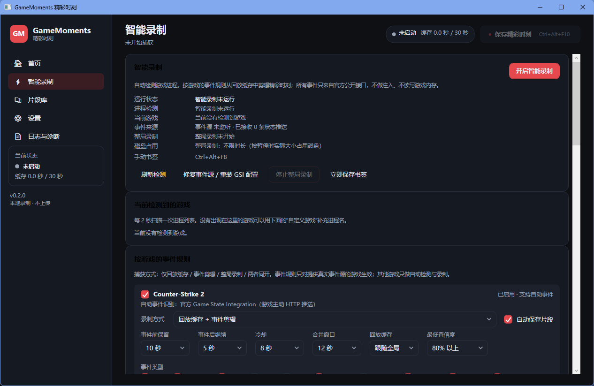

# GameMoments 精彩时刻

一个完全本地运行的 Windows 智能录制工具：它持续把最近一段时间的画面写入环形缓存，按下快捷键即可把“刚才那段”保存成 MP4；也可以随时开始/停止完整录制。0.2.0 起增加**智能录制**——自动检测游戏进程，通过游戏官方事件接口（CS2 的 Game State Integration）识别击杀、拆弹等事件，按规则自动剪辑并保存。灵感来自 SteelSeries Moments，但不依赖任何游戏平台或硬件厂商软件，也不读取游戏内存、不注入 DLL、不绕过任何保护。

> 当前版本 **0.2.0**，面向 Windows 10/11 x64。默认界面为中文，所有素材只写入本机。
>
> 下载：[GitHub Releases · v0.2.0](https://github.com/K1tor/GameMoments/releases/tag/v0.2.0)（`GameMoments-0.2.0-win-x64.zip`，123 MB，解压即用，含 ffmpeg，无需安装 .NET 运行时）


## 功能

### 已实现并实测

| 功能 | 说明 |
| --- | --- |
| 即时回放缓存 | 15/30/60/120 秒可选，按 1 秒一个 MP4 分段滚动写入，超出窗口自动删除最旧分段，并按磁盘上限（默认 20 GB）二次保护 |
| 保存精彩时刻 | 默认 `Ctrl+Alt+F10`，保存按键前一段 + 可选按键后 0/5/10 秒；保存期间锁定所需分段，不会清空未写完的数据 |
| 完整录制 | 默认 `Ctrl+Alt+F9` 开始/停止，产物与回放片段同一套命名与片段库 |
| 捕获源 | 自动枚举显示器，可指定显示器；桌面复制（DDA/GPU 零拷贝）优先，GDI 兼容回退 |
| 编码 | 启动时真实探测“捕获 + 编码器”组合：NVENC / AMF / QSV / Media Foundation 优先，失败自动回退 libx264；支持 30/60 fps 与三档画质 |
| 音频 | 系统声音（默认输出设备 loopback）与麦克风独立开关、独立音量；统一 48 kHz 双声道，按墙钟补静音保证音画对齐；保存时裁剪并混流为 AAC |
| 输出 | MP4（H.264 + AAC，faststart），自动生成 JPG 缩略图；文件名前缀 + 时间戳 |
| 片段库 | 列表、搜索、缩略图、时长/分辨率/大小/有无音频等元数据、播放、打开所在位置、重命名、删除（进回收站并二次确认）、刷新与占用统计；事件片段额外标注游戏与事件类型 |
| 设置 | 捕获显示器/方式/编码器、帧率、缓存时长、按键后时长、画质、文件名前缀、音频设备与音量、三个全局快捷键、保存目录、托盘行为、日志保留天数、智能录制总开关与 GSI 端口；保存、恢复默认、导出诊断包 |
| 全局快捷键 | 可配置，注册失败（如 1409 被占用）会明确提示并保留界面按钮作为替代操作 |
| 托盘与引导 | 托盘图标、最小化/关闭到托盘、托盘菜单、保存通知、首次运行三步引导 |
| 日志与诊断 | 按天 JSONL 日志（不记录窗口标题、账号、画面），日志页可刷新/打开目录/导出 zip 诊断包（系统信息 + 设置 + 日志） |
| 隐私 | 只写本地目录，不联网上传，不采集密码；日志中的用户目录会脱敏为 `%USERPROFILE%` |

### 智能录制（0.2.0 新增）

| 能力 | 说明 |
| --- | --- |
| 游戏自动检测 | 每 2 秒扫描进程，按内置游戏目录 + 用户自定义 exe 列表匹配；区分前台/后台运行；游戏启动/退出触发对应的录制动作 |
| 事件源架构 | `IGameEventAdapter` 可插拔接口，事件来源限定为游戏官方提供的接口：优先级 官方 API / GSI / 公开日志 / 回放文件 / OCR，音频仅作辅助；不做注入、读内存、模拟按键 |
| CS2 事件识别 | 通过 CS2 官方 GSI（`gamestate_integration_*.cfg` + 本地 HTTP 推送）解析状态，按前后两帧差异推导事件：击杀、爆头、多杀（双杀/三杀/四杀/五杀 ACE）、助攻、阵亡、回合胜/负、安放炸弹、拆除炸弹、炸弹爆炸、比赛结束、事件源连通。置信度 1.0（官方数据） |
| 事件规则 | 每个游戏独立配置：启用开关、录制模式、事件前保留时长、事件后继续录制、冷却时间、合并窗口、最低置信度、自动保存 vs 只加书签，以及逐事件类型开关（击杀/爆头/多杀/助攻/回合胜/拆除/爆炸/比赛结束…） |
| 保存语义 | 事件到达时从环形缓存取“事件前 N 秒 + 事件后 N 秒”剪成片段；合并窗口内的同类事件（如连续击杀）只存一次；冷却期内重复事件跳过；只加书签模式下仅记录事件，用户可稍后“从缓存补存” |
| 整局自动录制 | 游戏启动即开始整盘录制，退出时延迟安全结束；可设上限时长与停止延迟；提供“仅回放缓存 / 仅事件片段 / 整局 / 整局+事件”四种模式与磁盘占用预估 |
| 事件时间线 | 智能录制页展示最近事件（时间、游戏、类型、来源、置信度、决定、保存结果、片段名），可打开片段、从缓存补存、标记误触发（用于诊断） |
| 未支持游戏 | 明确标注“支持自动检测 / 手动录制，不支持自动事件识别”，不会假装识别事件 |
| 书签快捷键 | 默认 `Ctrl+Alt+F8`，任意时刻把当前缓存存成片段（带游戏/书签标记） |

实机界面（0.2.0 发布包截图）：



### 游戏支持矩阵

| 游戏 | 进程检测 | 自动事件识别 | 事件源 | 备注 |
| --- | --- | --- | --- | --- |
| Counter-Strike 2 | ✅ 自动检测 | ✅ 支持 | 官方 GSI（本地 HTTP 推送） | 唯一接入真实事件源的游戏；需安装 GSI 配置（见下） |
| Dota 2 | ✅ 自动检测 | ⛔ 未接入 | 有官方 GSI，未实现解析 | 仅自动检测 + 手动/整局录制 |
| Apex Legends | ✅ 自动检测 | ⛔ 不支持 | 无公开安全事件源 | 仅自动检测 + 手动/整局录制 |
| PUBG | ✅ 自动检测 | ⛔ 不支持 | 无公开安全事件源 | 同上 |
| 永劫无间 | ✅ 自动检测 | ⛔ 不支持 | 无公开安全事件源 | 同上 |
| Left 4 Dead 2 | ✅ 自动检测 | ⛔ 不支持 | 无公开安全事件源 | 同上 |
| 其他任意游戏 | ✅ 可在“自定义游戏”里加 exe | ⛔ 不支持 | — | 支持自动检测 / 手动录制，不支持自动事件识别 |

### 未实现 / 部分实现

- **窗口捕获**：只支持整块显示器，不支持指定某个窗口或游戏进程。
- **更多游戏的事件源**：目前只有 CS2 接通真实事件源；Dota 2 有官方 GSI 但尚未实现适配器，Apex/PUBG/永劫无间等没有安全的公开事件接口。
- **裁剪/修剪、批量导出、分享、录制浮层、崩溃恢复**均未实现。
- **HDR、全屏独占、DRM 内容、反作弊保护**：不保证可捕获，也不会尝试绕过任何保护；这类场景可能黑屏或直接失败。
- **同步精度**：分段粒度为 1 秒，片段起点与音频裁剪按墙钟对齐，误差约 ±1 秒；不是逐帧级精确剪辑。
- **多显示器**：一次只录一个显示器；混合 DPI / 不同刷新率未做深入测试。
- **帧率**：只提供 30/60，未开放 120/144。
- **安装与更新**：没有 MSI/安装器、代码签名、自动更新。

## 技术方案

```
┌──────────────┐   DDA / GDI    ┌──────────────┐  1s 分段 MP4  ┌────────────────┐
│ 显示器 / 桌面 │ ─────────────► │ ffmpeg 子进程 │ ────────────► │ 会话分段目录     │
└──────────────┘                │ + NVENC/x264 │               │ seg_00000.mp4… │
                                └──────────────┘               └───────┬────────┘
                                                                       │ 环形窗口
┌──────────────┐  WASAPI loopback / mic  ┌──────────────────┐          │
│ 系统声音/麦克风│ ─────────────────────► │ 采集线程 → 48k 立体声│          │
└──────────────┘                         │ → 1s WAV 分块     │          │
                                         └────────┬─────────┘          │
                                                  │ 按墙钟裁剪          │
                        ┌─────────────────────────▼────────────────────▼─────────┐
                        │ 保存：concat 分段（-c copy）→ 混音 AAC → MP4 + 缩略图      │
                        │       → clips.json 索引 → 界面通知 / 片段库              │
                        └────────────────────────────────────────────────────────┘

游戏事件源（与录制完全解耦）：
  游戏进程 ──GSI HTTP POST──► GsiServer(127.0.0.1:48123) ──► Cs2GsiAdapter(差分)
        ──► GameEvent ──► EventEngine(冷却/合并/置信度/类型开关/自动保存或书签)
        ──► SmartRecordingService ──► CaptureEngine.SaveEventClipAsync(事件前 N 秒 + 后 N 秒)
```

- **捕获/编码**：`ffmpeg` 子进程。桌面复制用 `ddagrab`（GPU 纹理直接进编码器），兼容回退 `gdigrab`；编码器优先硬件，失败回退 `libx264`。启动时用一个 0.6 秒的空输出探测组合，只有真实成功才启用。
- **环形缓存**：`-f segment -segment_time 1 -reset_timestamps 1`，每段以关键帧开头；`SegmentRing` 维护索引、按窗口/磁盘上限清理，保存时对所需分段 pin 引用计数。
- **音画同步**：以分段文件创建时间作为墙钟锚点；音频从会话开始按已采集帧数累计，缺数据补静音；保存时按 `片段起点 - 音频会话起点` 从 WAV 分块中裁剪等长 PCM。
- **音频**：NAudio 的 WASAPI loopback / 采集，`PcmConverter` 统一为 float32 立体声，线性重采样到 48 kHz，`ChunkedWavSink` 每秒落一个 WAV 分块。
- **组装**：`ffmpeg -f concat -c copy` 拼视频，WAV 侧裁剪拼接后与视频 `-c:v copy` 混流为 AAC 192 kbps。
- **事件源服务器**：`GsiServer` 用 `TcpListener` 在 `127.0.0.1` 上实现极简 HTTP/1.1（不用 `HttpListener`，避免 URL ACL 与管理员权限需求），端口被占用时自动向后试 8 个端口并把实际端口写进 GSI 配置；先回 2xx 再派发，保证游戏端不因超时判为失败。
- **事件推导**：`Cs2GsiAdapter` 维护“上一份状态”，对 `previously/added` 增量与全量报文都做合并，再按字段差值推导事件（例如 `round_kills` 从 1 变 3 → 击杀 + 双杀）。
- **规则引擎**：`EventEngine` 顺序判定 总开关 → 游戏开关 → 是否需要事件片段 → 类型开关 → 置信度 → 捕获是否就绪 → 合并窗口 → 冷却 → 自动保存/书签，结论与原因都写进事件记录，界面可直接看到“为什么没保存”。
- **编码器争抢**：事件片段与整局录制共用同一个 ffmpeg 捕获进程，事件保存只是切分已有分段，不会新开编码器，因此不会与游戏抢硬件编码单元；唯一的额外开销是保存时的 concat + 混流。
- **界面**：WPF（.NET 10），深色主题、中文文案；`MainViewModel` 通过事件把引擎/智能录制状态推给界面，所有状态文字来自真实后台状态。
- **数据**：默认 `%LOCALAPPDATA%\GameMoments`（可用环境变量 `GAMEMOMENTS_DATA` 覆盖），片段默认保存到 `%USERPROFILE%\Videos\GameMoments`（不可写时自动回退到数据目录 `clips`）。

## 目录结构

```
GameMoments/
├─ src/
│  ├─ GameMoments.Core/          # 无 UI 依赖的核心库
│  │  ├─ Audio/                  # WASAPI 设备、PCM 转换、重采样、WAV 分块、采集轨
│  │  ├─ Capture/                # SegmentRing（环形缓存）、CaptureEngine（会话/保存/事件切片）
│  │  ├─ Clips/                  # ClipRecord、索引、片段库、组装、回收站
│  │  ├─ Configuration/          # 设置模型（含按游戏配置）、持久化、画质预设
│  │  ├─ Gaming/                 # 智能录制：游戏目录、进程检测、GSI 服务器、CS2 适配器、
│  │  │                          #   事件规则引擎、GSI 配置安装器、编排服务
│  │  ├─ Hotkeys/                # 快捷键解析、RegisterHotKey 封装
│  │  ├─ Logging/                # JSONL 日志
│  │  ├─ Media/                  # ffmpeg 定位/能力/命令、探测、进度解析
│  │  ├─ Platform/               # 路径、显示器、进程、隐私脱敏
│  │  └─ Support/                # 诊断包
│  ├─ GameMoments.App/           # WPF 界面（首页/智能录制/片段库/设置/日志）
│  └─ GameMoments.Cli/           # 开发与验证用命令行（含 GSI 诊断子命令）
├─ tests/GameMoments.Tests/      # 无依赖控制台测试（48 项）
├─ tools/ffmpeg/                 # 开发期 ffmpeg 6.1.1 + ffprobe
├─ docs/screenshots/             # 实机截图
└─ dist/GameMoments-0.2.0-win-x64/  # 可运行发布包（自包含 + 内置 ffmpeg）
```

## 构建与运行

环境要求：Windows 10/11 x64、.NET SDK 10（仅构建需要；发布包自包含，运行时不需要装 .NET）。

仓库不包含 ffmpeg 二进制（约 158 MB）。首次构建或运行前，先取回 ffmpeg 6.1.1 到 `tools/ffmpeg/`：

```powershell
node tools/fetch-ffmpeg.mjs
```

应用会依次在以下位置寻找 ffmpeg：设置里的路径、`GAMEMOMENTS_FFMPEG_DIR`、程序目录下的 `ffmpeg/`、向上查找的 `tools/ffmpeg/`、PATH。

```powershell
# 构建
dotnet build GameMoments.slnx -c Release

# 直接运行源码
dotnet run --project src/GameMoments.App -c Release

# 运行测试（控制台 runner，PASS/FAIL + 退出码）
dotnet build tests/GameMoments.Tests -c Release
tests/GameMoments.Tests/bin/Release/net10.0-windows/GameMoments.Tests.exe

# 重新发布（自包含）
dotnet publish src/GameMoments.App -c Release -r win-x64 --self-contained true `
  -o dist/GameMoments-0.2.0-win-x64
# 再把 tools/ffmpeg 下的 ffmpeg.exe / ffprobe.exe 复制到发布目录的 ffmpeg/ 子目录
```

运行发布包：双击 `dist/GameMoments-0.2.0-win-x64/GameMoments.exe`（或 `run.cmd`）。

开发时可用环境变量隔离数据与指定 ffmpeg：

```powershell
$env:GAMEMOMENTS_DATA = "D:\tmp\gm-data"
$env:GAMEMOMENTS_FFMPEG_DIR = "D:\path\to\ffmpeg"   # 目录内需同时有 ffmpeg.exe 与 ffprobe.exe
```

### 命令行（验证与排查用）

```powershell
$cli = "src/GameMoments.Cli/bin/Release/net10.0-windows/GameMoments.Cli.exe"
& $cli doctor                 # 环境/ffmpeg/捕获组合自检
& $cli devices                # 枚举显示器与音频设备
& $cli capture --wait=20      # 实时捕获并保存一段
& $cli record --wait=15       # 整段录制
& $cli detect                 # 扫描正在运行的游戏，并打印支持矩阵
& $cli gsi-status             # 查看 CS2 GSI 配置状态（路径/是否本程序安装/端口）
& $cli gsi-install            # 安装 GSI 配置到 Steam 库（不覆盖他人文件）
& $cli gsi-remove             # 卸载本程序写入的 GSI 配置（他人文件保留）
& $cli gsi-serve              # 起一个事件源服务器，观察真实推送
& $cli gsi-smoke              # 端到端冒烟：真实 HTTP 推送 7 帧 CS2 状态并校验事件
& $cli smart-smoke            # 全链路冒烟：假游戏进程→自动检测→真实捕获→事件→自动存盘
```

`smart-smoke` 支持 `--port N`（事件源端口）、`--workdir PATH`（输出目录）、`--hold SECONDS`（每帧间隔）、`--data-dir PATH`。
它的“游戏”是系统程序 `ping.exe` 的副本伪装成 `cs2.exe`，报文仍是合成数据，但**进程检测、捕获、HTTP 事件源、适配器、规则引擎、ffmpeg 切片全部走生产代码路径**。

`gsi-status / gsi-install / gsi-remove` 都支持 `--target DIR` 指定自定义 cfg 目录（默认走 Steam 库真实路径），便于在不触碰真实安装目录的情况下验证读写行为。

## 智能录制使用说明

1. **打开总开关**：设置页或“智能录制”页点“开启智能录制”。程序开始监听 `http://127.0.0.1:48123/` 并每 2 秒扫描游戏进程。
2. **安装 CS2 事件源**：在“智能录制”页点“修复事件源 / 重装 GSI 配置”，程序会在
   `…\steamapps\common\Counter-Strike Global Offensive\game\csgo\cfg\gamestate_integration_gamemoments.cfg`
   写入自己的配置文件（文件名固定，不会覆盖 `gamestate_integration_pwa.cfg`、`gamestate_integration_steelseries.cfg` 等他人文件；若该文件名已存在但不是本程序写的，会拒绝写入并提示）。
   写入失败（权限/安全软件拦截）时会把相同内容导出到 `%LOCALAPPDATA%\GameMoments\gsi\`，并给出提示让用户手动复制或管理员运行，**不会假装成功**。
3. **按游戏配置**：在“按游戏的事件规则”卡片里为 CS2 选择模式（仅回放缓存 / 仅事件片段 / 整局 / 整局+事件）、事件前后时长、冷却、合并窗口、最低置信度、自动保存或只加书签，以及逐事件类型开关。
4. **开始游戏**：CS2 启动后程序自动开捕获（如需），进入对局后事件会实时出现在“最近事件”里；自动保存的片段直接进片段库，带游戏名与事件类型标注。
5. **手动补救**：只加书签模式下事件不会自动存盘，可在事件行点“从缓存补存”；随时可按 `Ctrl+Alt+F8` 保存当前缓存。
6. **诊断误触发**：事件行点“标记误触发”，记录会保留反馈标记，便于调整冷却/合并/置信度或关掉某个事件类型。

## 验证结果

### 0.2.0（本机实测，2026-10-27）

- 构建：`dotnet build GameMoments.slnx -c Release` 成功，**0 警告 0 错误**。
- 自动化测试：`GameMoments.Tests.exe` → **通过 48，失败 0**（在原有 23 项基础上新增 25 项：智能录制设置收敛与按游戏配置、自定义游戏规范化、深拷贝、三快捷键互斥、GSI 首帧/击杀/多杀/爆头/助攻/阵亡/回合胜负/炸弹/比赛结束、`previously/added` 增量合并、非法与非 CS2 负载容错、规则引擎的冷却/合并/置信度/类型开关/书签/未就绪/总开关、事件历史回写、GSI 配置生成与往返、他人文件保护、端口变更、支持矩阵文案）。
- 事件源端到端（真实 HTTP）：`GameMoments.Cli.exe gsi-smoke` 起真实 `GsiServer` 并用 `HttpClient` 推送 7 帧递进的 CS2 全量状态 → 7 次请求全部 2xx，错误 0，推导出 `connected, kill, headshot, multikill, assist, bomb_planted, round_loss, bomb_exploded, match_end` 9 类事件，退出码 0。
- **智能录制全链路（真实进程 + 真实捕获 + 真实 HTTP + 真实落盘）**：`GameMoments.Cli.exe smart-smoke --port 48213 --hold 2`
  以 `ping.exe` 的副本伪装成 `cs2.exe` 启动，让生产代码的 `GameDetectionService` 按内置目录真的识别到“游戏”，随后自动开捕获，
  再向真实 `GsiServer` 推送 7 帧 CS2 状态。结果：事件时间线 9 条，判定“已触发保存”3 次、同簇合并 3 次、类型关闭 2 次，
  片段库落盘 3 个真实 MP4（均 1920×1080、00:12、约 11 MB，带“游戏=Counter-Strike 2 / 事件=kill|bomb_planted|match_end”标注），
  `保存请求数 3 / 片段数 3`，退出码 0。规则被实际验证：击杀与安放炸弹各自成片，“事件前 8 秒 + 事件后 3 秒”，
  同簇内的爆头/多杀/后续击杀被判“与 4 秒内的同一事件簇合并”，助攻与回合失利命中默认关闭。
  该过程还暴露并修掉一个真实缺陷：退出时在途保存会在 `SemaphoreSlim` 已释放后再 `Release`（`ObjectDisposedException`）。
- GSI 配置文件真实往返（用 `--target` 指向工作区目录）：写入 518 字节 UTF-8 无 BOM，含 `"uri" "http://127.0.0.1:48123/cs2"` 与完整 data 段；改端口后重装会覆盖自己的文件；`gsi-remove` 能删除；预置他人文件时安装被拒绝且原文保留、卸载时不删除他人文件。
- 进程检测：`gsi-detect` 真实扫描本机进程，正确识别“当前没有游戏在运行”，并输出每款游戏的支持矩阵文案。
- 以下**未能**在本环境验证（如实记录）：
  - **真实 CS2 对局**：本机未启动 CS2 对局，无法验证游戏端真实推送、真实击杀事件与真实录制产物；已用真实 HTTP 冒烟覆盖协议解析与事件推导链路。
  - **真实写入 Steam 安装目录**：本机对该项目编译出的 exe 写入 `d:\steam\…` 与 `%LOCALAPPDATA%\GameMoments\gsi` 均被系统拒绝（`UnauthorizedAccessException`，ACL 正常、Windows Defender 已停止，系统安全中心报告存在第三方安全软件），而同目录用 bash/node/PowerShell 写入正常，判定为第三方安全软件对未签名新进程的限制。程序已实现上述降级导出与明确提示。
  - **智能模式的图形界面逐按钮交互**：页面渲染已截图核对（见上方实机截图），开关/按钮走的是与 `smart-smoke` 相同的服务层方法，
    但没有对每个按钮做 UIA 自动化点击验证。
- 0.1.0 的既有实测项（捕获组合探测、CLI 产物 ffprobe 校验、界面端到端保存、`WM_HOTKEY` 路径、回收站删除、发布包冒烟）在 0.2.0 构建上仍然通过。

### 0.1.0（历史记录，2026-10-26）

- 自动化测试 **通过 23，失败 0**；`ddagrab + h264_nvenc`、`gdigrab + libx264`、`gdigrab + h264_nvenc` 三种组合均探测通过。
- CLI 三次保存产物经 ffprobe 校验：10.000 s / 14.000 s / 7.000 s；分段精确 1.000 s、60 帧。
- 界面端到端：缓存 33 秒 → 保存 → `Moments_20261026_213703.mp4`（31.000 s、49.5 MB）；`WM_HOTKEY` 路径生成 16.000 s / 12.18 MB。

截图：`docs/screenshots/`（首次引导、首页、智能录制、片段库、设置），使用合成测试画面，不含真实桌面内容。


## 验收清单（对照《智能录制增强》提示词 v2）

| # | 要求 | 状态 | 说明 |
| --- | --- | --- | --- |
| 1 | 游戏自动检测（进程/窗口/自定义 exe 列表，按游戏单独配置，可单独禁用） | ✅ 已完成 | `GameDetectionService` 每 2 秒扫描；内置目录 + 自定义 exe（`exe` / `exe.exe` / `exe=显示名`）；每游戏 `Enabled` 开关与完整录制配置 |
| 2 | 可插拔 `GameAdapter` 事件源架构，优先级 官方 API > GSI > 公开日志 > 回放/插件 > OCR，禁止注入/读内存/绕反作弊 | ✅ 已完成 | `IGameEventAdapter` 接口 + `Cs2GsiAdapter` 实现；仅使用游戏官方 GSI 推送，无注入、无内存读取 |
| 3 | 至少一款游戏接通真实事件源端到端 | ✅ 已完成（CS2 GSI） | 协议层与事件推导用真实 HTTP 验证；真实对局推送需用户在装有 CS2 的机器上验证（本环境无对局） |
| 4 | EventEngine 事件规则可配（自动保存/事件前/事件后/冷却/合并/最低置信度/优先级） | ✅ 已完成 | 全部为按游戏可选参数，优先级用于同一窗口内事件取舍；判定原因写进事件记录 |
| 5 | 保存语义 = 事件前缓存 + 事件后继续录制 | ✅ 已完成 | `CaptureEngine.SaveEventClipAsync(事件前 N 秒 → 事件时刻 + 事件后 N 秒)`，与即时回放共用分段与混流管线 |
| 6 | 智能录制设置界面（总开关/当前游戏/检测状态/按游戏事件开关/前后时长/冷却/合并/自动保存 vs 书签/最近事件与保存结果/误触发反馈） | ✅ 已完成 | 新增“智能录制”页 7 张卡片 + 设置页智能录制卡；主页状态卡同步 |
| 7 | 整局自动录制（启动自动开始、退出安全结束、单文件/分段、四种模式、磁盘预估、编码器协调） | ✅ 已完成 | 启动即录、退出延迟安全结束、可设上限时长；整局产物为单文件（内部 1 秒分段拼接）；四种模式齐备；按码率×时长给出磁盘预估；事件切片复用同一 ffmpeg 进程不额外争抢编码器 |
| 8 | 未支持游戏明确标注“支持自动检测/手动录制，不支持自动事件识别” | ✅ 已完成 | `GameDefinition.CaptureOnlyText` 在界面与 CLI 支持矩阵中统一输出该文案 |
| 9 | 模拟事件仅用于测试，不得冒充真实测试 | ✅ 已完成 | 模拟报文只在 `gsi-smoke` 与单元测试中使用，并在文档中标注为“模拟推送” |
| 10 | 不得覆盖用户文件（GSI cfg 安装须先检查、可逆） | ✅ 已完成 | 固定文件名、内容含 `GameMoments` 标记；他人文件拒绝覆盖；卸载仅删除本程序写入的文件；已实测往返 |
| 11 | 真实测试与性能数据 | ⚠️ 部分完成 | 自动化 48 项 + 真实 HTTP 7 帧端到端 + 真实文件往返 + `smart-smoke` 全链路（真实进程/捕获/落盘）通过；**真实 CS2 对局未验证**（本机无法启动对局），GUI 未逐按钮自动化 |

## 已知限制

1. 缓存与保存以 1 秒分段为单位，片段起点/终点误差约 ±1 秒；不提供逐帧裁剪。
2. 只录整块显示器，不能指定窗口；混合 DPI、HDR、全屏独占、DRM、反作弊场景可能黑屏或无法捕获（工具不会绕过保护）。
3. 音频对齐依赖墙钟与设备时钟，长时间录制可能有毫秒级漂移；设备被拔出/切换后需要重新开始捕获（界面会提示）。
4. 快捷键注册失败时（常见 1409 被其他程序占用）需要换组合或使用界面按钮。
5. 保存目录不可写时会自动回退到数据目录 `clips`，日志与设置页会说明原因。
6. 没有安装器、签名与自动更新；发布包约 315 MB（自包含 .NET + ffmpeg），压缩包约 123 MB（已发布在 [Releases v0.2.0](https://github.com/K1tor/GameMoments/releases/tag/v0.2.0)，附 SHA-256）。
7. 事件识别目前仅支持 CS2；其他游戏（含 Dota 2）只有进程检测 + 手动/整局录制。
8. CS2 的 GSI 配置需写入游戏安装目录，若被系统权限或第三方安全软件拦截，需要按提示手动复制或用管理员身份运行；程序不会伪造“已安装”。
9. 智能录制的真机表现（开启游戏→自动开捕获→事件自动存盘）需要真实对局验证，本仓库的自动化测试只覆盖到协议与规则层。
10. 事件来源依赖游戏自身的 GSI 输出频率（CS2 约 0.2 秒节流），极短的连续事件（同一帧内的两次击杀）会被合并为一次多杀。

## 依赖与许可

- 本项目代码：MIT，见 `LICENSE`。
- FFmpeg 6.1.1 essentials（gyan.dev 构建，GPL）：随包放在 `ffmpeg/`，未修改，附 `ffmpeg/win32-x64.LICENSE`，源码见 <https://ffmpeg.org> 与 <https://www.gyan.dev/ffmpeg/builds/>。
- NAudio 2.2.1（MIT）：WASAPI 采集。
- .NET 10 / WPF（MIT）。
- CS2 Game State Integration：Valve 官方提供的游戏内数据推送机制（<https://developer.valvesoftware.com/wiki/Counter-Strike:_Global_Offensive_Game_State_Integration>），本项目只作为本地 HTTP 客户端接收，不包含任何 Valve 代码或资源；未使用任何第三方 GSI 库。

详见 `THIRD-PARTY-NOTICES.md`。

## 故障排查

- 启动失败/找不到 ffmpeg：确认 `ffmpeg/ffmpeg.exe` 与 `ffmpeg/ffprobe.exe` 同时存在，或在设置里指定 ffmpeg 路径，或设置 `GAMEMOMENTS_FFMPEG_DIR`。
- 捕获黑屏：换“捕获方式”为 GDI 再试；确认不是 DRM/独占全屏/反作弊保护画面。
- 没有声音：设置页确认“录制系统声音”已勾选且设备是当前默认输出；麦克风需单独勾选。
- 保存失败：查看“日志与诊断”页（可导出诊断包），常见原因是磁盘空间不足或保存目录无权限。
- 快捷键无效：设置页重新录入；日志会记录注册失败原因。
- 智能录制没反应：确认总开关已开、该游戏模式不是“关闭”，并点“刷新检测”看是否识别到进程；`gsi-status` 可查看配置路径与端口。
- 游戏里没有事件：先确认 GSI 配置已安装且端口与界面一致（改端口后需重装配置），再用 `gsi-serve` 观察是否有推送；若一直无推送，检查 CS2 启动参数/防火墙是否拦截本机回环。
- 事件都只进了书签没有自动保存：检查该游戏是否选了“只加书签”模式、事件类型开关、最低置信度与冷却时间；事件行的“决定/说明”列会写出原因。
- GSI 配置写入失败：按提示把导出到 `%LOCALAPPDATA%\GameMoments\gsi\gamestate_integration_gamemoments.cfg` 的文件复制到 `…\game\csgo\cfg\`，或右键以管理员身份运行本程序后点“修复事件源”。
